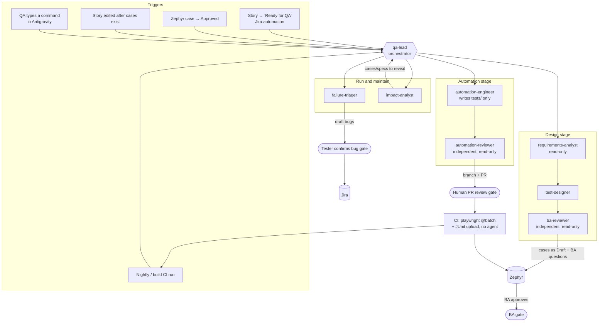

# QA agent architecture, unconstrained

This is the version I'd build with no limit on the number of agents or skills. It builds on
[orchestrator-design.md](orchestrator-design.md); the twg, Zephyr, Playwright and CI details there still apply.

## 1. How to decide what is an agent, a skill, or a script

The question isn't how many agents to have. Each piece of work goes to the cheapest thing that can do it safely:

| Make it a… | When | Examples here |
|---|---|---|
| **Script / CI step** | The work is deterministic. An LLM adds cost and randomness. | Zephyr API calls, running Playwright, uploading JUnit, the traceability report |
| **Skill** | Know-how that one or more agents apply | Test design techniques, BA rubric, Playwright conventions, the twg skills |
| **Agent** | It needs **its own context** (independent judgment), **its own tool limits** (read-only or write), or **its own trigger** | BA reviewer, failure triager |
| **Human gate** | A person is accountable for the decision | BA approval, merging test code, filing a bug |

Two more rules:
- **State lives in the systems of record**: Jira, Zephyr and Git. Chat and agent memory don't hold it. Any stage can
  restart from a story key, and a person can see where every story stands without asking an agent.
- **Approvals happen where the work is reviewed.** Test cases are approved in Zephyr, code in a pull request, and bugs in Jira.
  Chat approvals are only for interactive local runs.

## 2. The architecture

## 3. Agents

| Agent | Job | Tools | Why it's a separate agent |
|---|---|---|---|
| **qa-lead** (orchestrator) | Reads the trigger, works out what stage the story is in from Jira and Zephyr, sends the work to the right agent, writes the run log. Writes nothing else. | read, `invoke_subagent`, `manage_task`, write to `.qa/` only | Keeps routing apart from doing, as `sdlc-sherlock` does |
| **requirements-analyst** | Pulls the story, its acceptance criteria, linked Confluence/BRD pages, the epic and related issues through twg. Produces a **requirement digest** and **testability findings**: vague acceptance criteria, missing rules, contradictions. | read, twg (read commands) | Ambiguities reach the BA *before* anyone writes test cases. This is the cheapest point to fix a requirement. |
| **test-designer** | Turns the digest into test cases using design techniques. Every case traces to an acceptance criterion and says whether it's automatable. | read, write `.qa/`, `zephyr.mjs` | The main author |
| **ba-reviewer** | Scores the cases against the rubric. It sees **only the digest and the cases**, never the designer's reasoning. | read only | Independent review is the point. A reviewer that shares the author's context grades its own homework. |
| **automation-engineer** | Approved cases → Playwright specs, page objects and fixtures. Dry-runs twice and classifies failures. | read, write `tests/` only, `run_command` | Write access confined to the test folder |
| **automation-reviewer** | Reviews the spec diff for weak selectors, hard waits, shared state, writes to prod data, and test titles missing Zephyr keys. | read, `git diff` | A second look before a human sees the PR, and catches flakiness causes early |
| **failure-triager** | After each CI run, reads JUnit and the Playwright traces. Sorts each failure into **app defect, script broken, environment, or flaky**. Drafts Jira bugs with trace evidence and proposes selector fixes as a PR. | read, `run_command` (rerun one test), twg (draft only) | Has its own trigger (CI), and it's what keeps the nightly batch trusted over time |
| **impact-analyst** | When a story or its Confluence page changes after cases exist, lists which Zephyr cases and specs are now stale. | read, twg, `zephyr.mjs list` | Has its own trigger. Without it, the suite quietly drifts from the requirements. |

That's eight agents. Merge the two reviewers into their authors if cost matters. Keep **ba-reviewer**
separate whatever happens: the meeting asked for it specifically, and independence is what makes it useful.

## 4. Skills (shared know-how)

| Skill | Used by | Contents |
|---|---|---|
| `twg`, `twg-workflows` | analyst, triager, impact | From Atlassian's installer. Not yours to maintain. |
| `qa-requirement-analysis` | analyst | Acceptance-criteria parsing, testability checklist, how to word a question for the BA |
| `qa-test-design` | designer | Equivalence classes, boundaries, decision tables, state transitions, negative/role/data cases |
| `qa-test-case-format` | designer, ba-reviewer, automation-engineer | The team template + mapping to Zephyr fields. One shared format means the stages agree. |
| `qa-ba-review-rubric` | ba-reviewer | Scored criteria: coverage, traceability, observable results, nothing invented, data safety |
| `qa-playwright-conventions` | automation-engineer, automation-reviewer | Locators, web-first assertions, fixtures, tagging, Zephyr key in titles. Add Salesforce Lightning patterns if the app is Salesforce. |
| `qa-test-data` | designer, automation-engineer | The prod-data rule, what's read-only, how fixtures create and clean data |
| `qa-failure-triage` | failure-triager | The four failure classes, the evidence each needs, the bug template |
| `qa-zephyr` | designer, engineer, triager | How to call `zephyr.mjs`: statuses, links, cycles |

The reviewer and the author load the **same** format and conventions skills, so they're checking against the
same rules. Only the rubric is reviewer-specific.

## 5. Scripts and CI (deterministic)

- `zephyr.mjs`: create, list, get-status, link, add-comment. The only code that touches Zephyr.
- `zephyr-upload.mjs`: JUnit → test cycle. Used by CI and by dry runs.
- `traceability.mjs`: story → acceptance criteria → Zephyr cases → spec → last result, as one table.
  You can show it in a team meeting, and the agents read it to find gaps.
- CI job: `npx playwright test --grep @batch`, then upload, then (optionally) trigger failure-triager.

## 6. Lifecycle of one story

| # | Trigger | Who | Output | Gate |
|---|---|---|---|---|
| 1 | Story → Ready for QA | requirements-analyst | Digest + BA questions as a Jira comment | BA answers (optional, async) |
| 2 | Questions answered, or none | test-designer → ba-reviewer | Cases in Zephyr as `Draft` + review findings | **BA sets `Approved` in Zephyr** |
| 3 | Approved | Tester | Manual cycle for cases marked non-automatable, or first exploratory pass | — |
| 4 | Approved + automatable | automation-engineer → automation-reviewer | Branch + PR with specs, dry run ×2 green | **Human merges PR** |
| 5 | Merge | CI | Specs join `@batch`, nightly + on build | — |
| 6 | CI failures | failure-triager | Classified failures, draft bugs, fix PRs | **Tester confirms each bug** |
| 7 | Story changed | impact-analyst | Stale cases/specs flagged, re-enters step 2 or 4 | — |

On manual execution: in the meeting, every case was run by hand before it was automated. Once automation exists,
you'd keep manual runs for non-automatable cases and the first exploratory pass, and stop re-running by hand
what the batch already covers. Raise this with the team rather than assuming it.

## 7. How it runs: two modes, same agents

1. **Interactive (start here).** QA runs `/qa-design PROJ-123` and `/qa-automate PROJ-123` in Antigravity.
   Gates are chat approvals plus Zephyr and the PR.
2. **Event-driven (later).** Jira automation and CI call a runner that executes the same agent headless
   (`agy -p --agent qa-lead "…"`). All gates are then Zephyr status, PR review and Jira, with no chat.
   This needs non-interactive auth for twg and Zephyr in that runner. Confirm with Atlassian
   docs and your admins whether a scoped token works there before you plan around it.

Because state is in Jira, Zephyr and Git, moving from mode 1 to mode 2 changes **only the triggers**. No agent changes.

## 8. Keeping the agents good

- **Golden set.** Take 10–20 past stories whose cases the BA already approved. When a skill or prompt changes,
  rerun design on them and compare coverage against the approved set. These are tests for your skills.
- **Metrics from Zephyr/Jira, not opinions:**
  - share of agent-drafted cases the BA approves without edits
  - acceptance-criteria coverage per story
  - flaky rate in the batch
  - time from Ready for QA to automated
  - bugs found by the batch vs. escaped to UAT
- **Run log** `.qa/<KEY>/` per story (as your agy-framework's artifact log does), plus a summary comment on the Jira story.
- **Guardrails** (enforced by tool lists and a hook, not just instructions): only `zephyr.mjs` writes to
  Zephyr, only the engineer writes `tests/`, nobody commits to main, no prod writes, no tokens in chat.

## 9. Build order

1. Scripts first: `zephyr.mjs`, Playwright config + SSO setup, the CI job. These are useful even with no agents.
2. requirements-analyst + test-designer + ba-reviewer, interactive, on the golden set.
3. automation-engineer + automation-reviewer, PR-based.
4. failure-triager on the nightly run.
5. impact-analyst.
6. Event-driven triggers, once headless auth is solved.

Each step delivers something on its own, so the team sees value after step 1 or 2 without waiting for all eight agents.
