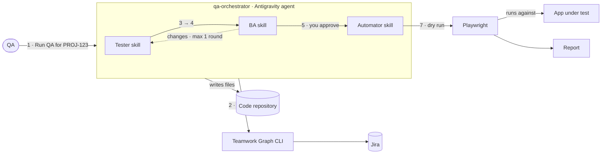

# QA Agent POC

An AI agent that takes a Jira story and produces reviewed test cases and a Playwright script,
following the team's QA process. It runs in Google Antigravity: one orchestrator agent and three
skills, **Tester**, **BA** and **Automator**.

Slide: [qa-poc-architecture.pptx](qa-poc-architecture.pptx)

## 1. Background

This comes from a team meeting about the test automation workflow
([meeting-notes.md](meeting-notes.md)). The agreed process is:

1. The tester writes test cases from the user story, BRD or Confluence requirement.
2. The BA reviews them, because the BA brought the requirement.
3. The tester runs them manually. This is slow.
4. The automator automates the BA-approved test cases in Playwright (Node.js).
5. After a dry run, the scripts join a batch that runs nightly or on each CI/CD build.

The POC automates steps 1, 2 and 4 with an agent, and keeps the approval with a person.

## 2. Architecture



| Component | What it is | Role in the POC |
|---|---|---|
| **qa-orchestrator** | Antigravity agent (`.agents/agents/qa-orchestrator.md`) | Runs the steps in order, passes each output to the next step, stops for your approval |
| **Tester** | Skill (`.agents/skills/tester/`) | Writes test cases from the story's acceptance criteria |
| **BA** | Skill (`.agents/skills/ba/`) | Reviews the test cases against the story. Approves, or lists required changes |
| **Automator** | Skill (`.agents/skills/automator/`) | Turns approved cases into a Playwright spec and dry-runs it |
| **Teamwork Graph CLI** | Atlassian's `twg` CLI and its `twg` / `twg-workflows` skills | Reads the Jira story, acceptance criteria and linked Confluence pages. Read-only in the POC |
| **Playwright** | `@playwright/test` 1.64, Node.js | Runs the generated spec against the app under test |
| **Code repository** | This folder | Holds the agent, skills, test cases (`.qa/`) and specs (`tests/e2e/`) |

## 3. Process flow

| # | Step | Who | Output |
|---|---|---|---|
| 1 | **Start.** Open `qa-orchestrator` and say `Run QA for PROJ-123` | QA | — |
| 2 | **Read the story** through the Teamwork Graph CLI | Orchestrator | `.qa/<KEY>/story.md` |
| 3 | **Write test cases**, each traced to an acceptance criterion | Tester skill | `.qa/<KEY>/test-cases.md` |
| 4 | **Review** coverage, expected results and invented requirements. If changes are needed, Tester revises once | BA skill | `.qa/<KEY>/review.md` |
| 5 | **Approve** in chat (`approve`, `change: <what>` or `stop`). You stand in for the BA during the POC | You | `.qa/<KEY>/approval.md` |
| 6 | **Automate** one Playwright test per approved case, with the case ID in the test name | Automator skill | `tests/e2e/<KEY>.spec.js` |
| 7 | **Dry run and report**: run the spec, fix script problems (max 2 rounds), report suspected defects | Automator skill | `.qa/<KEY>/automation-report.md` |

Nothing is automated before step 5. The orchestrator saves every step in `.qa/<KEY>/`, so when you
reply it can tell where the run is and continue.

## 4. The skills

### Tester
- At least one positive case per acceptance criterion. Negative and boundary cases only where the
  criterion implies a rule (a limit, a required field, a permission).
- One behaviour per case, IDs `<KEY>-TC01`, `<KEY>-TC02`, …
- Each case lists the criterion it covers, preconditions, test data, steps, expected result, and
  whether it can be automated.
- Anything unclear goes under **Open questions**. The skill doesn't guess.

### BA
Five checks. A failure makes the verdict `CHANGES`. Wording suggestions don't block.
1. **Coverage:** every acceptance criterion has a case.
2. **Correct:** expected results match the story.
3. **Specific:** expected results can be checked ("works correctly" fails).
4. **Nothing invented:** no case tests a rule the story doesn't state.
5. **Test data:** follows the test data rule in `AGENTS.md`.

### Automator
- Skips cases marked not automatable.
- Locators in order of preference: `getByRole`, `getByLabel`, `getByText`, `getByTestId`.
- Web-first assertions (`await expect(...)`), never `waitForTimeout`.
- Sorts each dry-run failure:
  - **script problem:** fixes it, at most 2 rounds
  - **app doesn't match the expected result:** reports a suspected defect and never changes the expectation
  - **can't log in or reach the app:** stops

## 5. Repository layout

```text
watson/
├── .agents/
│   ├── agents/qa-orchestrator.md     orchestrator agent
│   └── skills/
│       ├── tester/SKILL.md
│       ├── ba/SKILL.md
│       └── automator/SKILL.md
├── .qa/<KEY>/                        created per story: story, test cases, review, approval, report
├── tests/e2e/                        generated Playwright specs
├── AGENTS.md                         project context every agent reads: app URL, data rule, login
├── playwright.config.js
├── package.json
├── doc.md                            this document
├── poc-architecture.md               short POC summary
├── qa-poc-architecture.pptx          one-slide architecture
├── meeting-notes.md                  the meeting this came from
└── agentic-testing-architecture.pptx the wider integration architecture
```

`orchestrator-design.md` and `architecture-v2.md` are earlier, larger designs kept for reference.
The POC follows this document.

## 6. Setup

1. **Teamwork Graph CLI.** Install it from Atlassian, then:
   ```bash
   twg login
   ```
   ```bash
   twg doctor
   ```
   This installs the `twg` skills into `~/.agents/skills/`, where Antigravity picks them up.
2. **Playwright.**
   ```bash
   npm install
   ```
   ```bash
   npx playwright install chromium
   ```
3. **App and login.** Set `APP_URL`, then save a login once. Sign in in the browser that opens, then close it:
   ```bash
   npm run login -- <APP_URL>
   ```
   Tests reuse `.auth/user.json`. Repeat when the session expires.
4. **Run.**
   ```bash
   agy --agent qa-orchestrator
   ```
   Or pick `qa-orchestrator` in the Antigravity agent dropdown, then say `Run QA for PROJ-123`.

## 7. Rules the agent follows

- **Jira is read-only.** No comments, transitions or edits.
- **Tests don't change data.** The test environment uses production data, so tests only read and navigate.
- **No commits.** The agent never commits, pushes or creates branches. You review and commit.
- **No tokens in chat.** If `twg` isn't logged in, the agent tells you to run `twg login`.
- **Never run with `--dangerously-skip-permissions`.** That flag would approve every command and file write.

## 8. Status

| Item | State |
|---|---|
| Agent and three skills | Written. Antigravity CLI 1.4.10 loads `qa-orchestrator` with `tester`, `ba` and `automator` |
| Teamwork Graph CLI | Not installed on the dev machine yet |
| End-to-end run on a real story | Not done yet |
| Playwright dependencies | Declared in `package.json`, not installed yet |

## 9. Not in the POC

Added after the POC works on one real story:
- **Zephyr Scale:** test cases and results stored in Zephyr, with BA approval as a Zephyr status.
- **CI / nightly batch:** run approved specs nightly and on each build, then upload JUnit results.
- **Automated SSO login:** needs a test user with an MFA exemption or a non-interactive login.
- **Jira writes:** comments for the BA, and bugs for suspected defects.

## 10. Open questions

1. How will automated tests log in through SSO without someone approving MFA?
2. Can tests safely run against production data, or is a sandbox available?
3. What is "DP" in "data validation from DP"?
4. Should every approved case still be run manually before it's automated?
