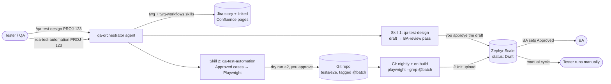

# QA orchestrator on Antigravity: design

One orchestrator agent, two skills, Jira through the Teamwork Graph CLI (`twg`), test cases in
Zephyr Scale, automation in Playwright (Node.js). Built from the workflow in
[meeting-notes.md](meeting-notes.md) and the architecture in `agentic-testing-architecture.pptx`
(option 4b).

## 1. The core idea

The agent does the authoring work. People keep the approvals, and the nightly run doesn't use an agent at all.

| Meeting step | Who does it now | Where approval lives |
|---|---|---|
| Write test cases from story / BRD / Confluence | **Skill 1** (`qa-test-design`) | — |
| Agent BA Reviewer | **Skill 1**, review pass | — |
| BA approves | **BA (human)**, in Zephyr | Zephyr test case status `Draft` → `Approved` |
| Tester runs manually | **Tester (human)**, Zephyr test cycle | Zephyr execution results |
| Automate approved cases + dry run | **Skill 2** (`qa-test-automation`) | You approve the dry-run result |
| Nightly batch / CI/CD run | **CI pipeline only** (Playwright + one upload call) | JUnit → Zephyr test cycle |

Two design rules come out of this:

1. **The approval lives in Zephyr, not in chat.** Skill 2 only picks up test cases whose Zephyr status
   is `Approved`. The BA approves in the tool they already use, and you can audit the approval later.
2. **No LLM in the nightly run.** CI runs `npx playwright test --grep @batch` and uploads the JUnit
   file. That keeps it deterministic, cheap, and free of agent logins. The agent's job ends once
   it writes the scripts.

## 2. Architecture



**Four skills in the session, two of them yours:**
- `twg` and `twg-workflows` come from the TWG installer, written to `~/.agents/skills/`. Antigravity
  reads `.agents/skills/` the same way your agy-framework does. These teach the agent the `twg` commands,
  so your skills never have to explain Jira access.
- `qa-test-design` and `qa-test-automation` are yours. They hold the team's process. They go in the
  repo's `.agents/skills/` so the whole team shares them.

## 3. Repository layout

```text
<app-test-repo>/
├── .agents/
│   ├── agents/
│   │   └── qa-orchestrator.md
│   └── skills/
│       ├── qa-test-design/
│       │   ├── SKILL.md
│       │   ├── resources/
│       │   │   ├── test-case-template.md      the team's test case format
│       │   │   └── ba-review-checklist.md      what the "Agent BA Reviewer" checks
│       │   └── scripts/
│       │       └── zephyr.mjs                  create / list / get-status test cases
│       └── qa-test-automation/
│           ├── SKILL.md
│           ├── resources/
│           │   └── playwright-conventions.md   selectors, waits, naming, data rules
│           └── scripts/
│               └── zephyr-upload.mjs           POST JUnit to Zephyr (shared with CI)
├── tests/e2e/                                  Playwright specs, one file per story
├── tests/e2e/auth.setup.ts                     SSO login once → storageState
├── playwright.config.ts                        junit reporter + setup project
└── AGENTS.md                                   app URL, test env, data rules, Zephyr project key
```

Don't prefix these with `sdlc-`. In your agy-framework that prefix makes a skill a lifecycle and
puts it under the hook's write protection.

## 4. The orchestrator

`.agents/agents/qa-orchestrator.md`:

```markdown
---
name: qa-orchestrator
description: QA orchestrator for turning Jira stories into reviewed test cases and Playwright
  automation. Start here for /qa-test-design <issue> and /qa-test-automation <issue>.
mainAgent: true
subagent: false
model: inherit
commandExecutionPolicy: <a policy that prompts per command and allows network; see §8>
tools:
  - view_file
  - grep_search
  - write_to_file
  - replace_file_content
  - run_command
  - manage_task
skills:
  - skills/qa-test-design
  - skills/qa-test-automation
---
# Role
You coordinate QA work for one Jira story at a time. You never mark anything approved yourself:
BA approval is a Zephyr status a person sets, and every write to Jira, Zephyr, or the repo waits
for the user's "approve" in this chat.

# Routing
- /qa-test-design <KEY>  → follow the qa-test-design skill.
- /qa-test-automation <KEY> → follow the qa-test-automation skill.
- Anything else → answer in one line that this agent handles those two commands.

# Every run
1. Fetch context with the twg skills: the work item, its acceptance criteria, linked
   Confluence pages, parent epic, and linked issues. Save it to .qa/<KEY>/00-context.md.
2. Follow the skill. Write each stage to .qa/<KEY>/NN-<stage>.md so a stopped run can resume.
3. Before any write outside .qa/: show what will be written and stop with
   "Awaiting approval: <what>". Continue only on "approve".
4. End with a short recap: what was created (Zephyr keys, file paths), what is waiting on whom.

# Limits
Never run tests against production unless AGENTS.md says the suite is read-only.
Never commit, push, or transition Jira issues. Never paste or ask for tokens.
```

Why one agent and not orchestrator + subagents: your process has two clear stages with a human
between them, so each command is a short single-context run. Add a subagent only when you want
the **BA review to be independent** (see §5, step 4).

## 5. Skill 1: `qa-test-design`

**Input:** a Jira key. **Output:** test cases in Zephyr as `Draft`, linked to the story, with a
comment on the story asking the BA to review.

Steps for `SKILL.md`:

1. **Read the requirement.** Use `00-context.md`: acceptance criteria first, then the Confluence or
   BRD pages linked to it. If the story has no acceptance criteria, stop and say so. Don't
   invent requirements.
2. **Build a coverage map.** List each acceptance criterion and the scenarios it needs: happy path,
   negative paths, boundaries, roles/permissions, and data states.
3. **Draft test cases** in `resources/test-case-template.md` format: objective, preconditions,
   test data, steps with expected results, priority, and the acceptance criterion it traces to. Mark each
   case `automatable: yes/no/partly` with a reason. Skill 2 uses this.
4. **Agent BA Reviewer pass.** Check the draft against `resources/ba-review-checklist.md`:
   - every acceptance criterion has at least one case, and every case traces to one
   - expected results are observable (not "works correctly")
   - no requirement invented beyond the story and its docs
   - ambiguities raised as **questions for the BA**, not resolved by guessing
   - test data respects the prod-data rule (read-only unless stated)

   Output: findings plus the list of BA questions. *Upgrade later:* run this pass in a
   read-only subagent with fresh context, so the reviewer isn't grading its own draft.
5. **Show the draft, the review findings, and the BA questions.** Stop: `Awaiting approval`.
6. **On approve:** run `scripts/zephyr.mjs create` for each case (status `Draft`, linked to the
   story's issue, labels such as `agent-drafted`). Then post one Jira comment via `twg`
   tagging the BA with the Zephyr keys and the open questions.

## 6. Skill 2: `qa-test-automation`

**Input:** a Jira key. **Output:** Playwright specs for the story's **Approved** cases, a passing
dry run, and the cases tagged into the batch.

Steps for `SKILL.md`:

1. **Gate on approval.** Run `scripts/zephyr.mjs list --issue <KEY>`. Keep only cases with status
   `Approved` and `automatable` set to yes or partly. If none qualify, stop and say who it is waiting on.
2. **Read the app.** Open the target pages (from `AGENTS.md`) and find stable selectors. Prefer
   `getByRole`, `getByLabel`, and `data-testid`. For Salesforce Lightning, avoid generated ids.
3. **Plan the specs.** One file per story, `tests/e2e/<KEY>.spec.ts`, and one `test()` per Zephyr
   case. **Put the Zephyr key in the test title** (`'SHOP-T12 rejects expired card'`), because the JUnit
   upload uses it to map results to cases. Show the plan, then stop: `Awaiting approval`.
4. **Write the specs** following `resources/playwright-conventions.md`: no `waitForTimeout`,
   web-first assertions, test data from fixtures, no writes against prod data.
5. **Dry run.** Run `npx playwright test tests/e2e/<KEY>.spec.ts` **twice**. Sort each failure:
   - *script bug*: fix and rerun
   - *app doesn't meet the expected result*: a **suspected defect**. Leave the test out of the batch
     and offer to raise a Jira bug via `twg` (after approval)
   - *passes once, fails once*: **flaky**. Fix the waits or data, never add retries
6. **Add to the batch.** Tag passing tests `@batch` (`test('SHOP-T12 …', { tag: '@batch' }, …)`).
   Upload the dry-run JUnit with `scripts/zephyr-upload.mjs`, so the cases show as automated
   with a first result.
7. **Recap.** Files written, tests in the batch, suspected defects. The user reviews the diff and commits.

## 7. Playwright + CI (no agent)

`playwright.config.ts` essentials:

```ts
export default defineConfig({
  reporter: [['list'], ['junit', { outputFile: 'results/junit.xml' }]],
  use: { baseURL: process.env.APP_URL, trace: 'retain-on-failure' },
  projects: [
    { name: 'setup', testMatch: /auth\.setup\.ts/ },
    { name: 'e2e', dependencies: ['setup'],
      use: { storageState: '.auth/user.json' } },
  ],
});
```

- **Incognito mode:** every Playwright browser context is already a fresh, incognito-style
  profile. You don't need a flag.
- **SSO:** `auth.setup.ts` logs in once per run and saves `storageState`. MFA is still the open
  problem from the meeting. You need a test user with an MFA exemption or a non-interactive
  login your identity team approves.

CI job (nightly cron + on build), any CI system:

```bash
npx playwright test --grep @batch
node .agents/skills/qa-test-automation/scripts/zephyr-upload.mjs results/junit.xml
```

The upload calls Zephyr Scale Cloud's
`POST https://api.zephyrscale.smartbear.com/v2/automations/executions/junit?projectKey=<KEY>`
(multipart `file`, bearer `ZEPHYR_TOKEN`). Leave `autoCreateTestCases=false` so only the
reviewed cases receive results. Each upload creates a test cycle.

## 8. Setup and secrets

| Thing | How | Note |
|---|---|---|
| TWG CLI | Install from Atlassian, then `twg login` (OAuth 2.1 in browser), then `twg doctor` | Skills install to `~/.agents/skills/`. Credentials are in the OS vault. Never put tokens in chat. |
| Zephyr token | Zephyr Scale → API Access Tokens → env var `ZEPHYR_TOKEN` | Used by both scripts and CI |
| Antigravity command policy | Pick one that **prompts per command** and allows network | `twg` must reach Atlassian and the OS vault. Your agy-framework notes say `sandbox` may block outside access, so test this first. |
| Never | `--dangerously-skip-permissions` | It would auto-approve Zephyr/Jira writes |

## 9. Build order

1. **Spike (1 story):** install `twg`, run `/qa-test-design` with only steps 1–5 of Skill 1 (no
   writes). Check the context and draft quality with your BA.
2. Write `zephyr.mjs` (create, list, status) and finish Skill 1 with real Zephyr writes.
3. Playwright skeleton: config, `auth.setup.ts`, one hand-written test. This is where SSO gets solved.
4. Skill 2 against the spike story's approved cases, through the dry run.
5. CI job with `@batch` + upload.
6. Optional: independent BA-review subagent, a `/qa-triage` mode that reads the nightly failures and
   drafts Jira bugs.

## 10. Open questions that change the design

- **SSO/MFA for the test user.** This blocks step 3 and CI.
- **Prod data.** If tests must create records, you need a sandbox, or cleanup in fixtures.
- **Zephyr statuses.** Does your Zephyr project use `Draft`/`Approved`, or custom statuses?
- **Does `twg` cover Zephyr?** Zephyr is a Marketplace app, so assume not. That's why the
  `zephyr.mjs` script exists.
