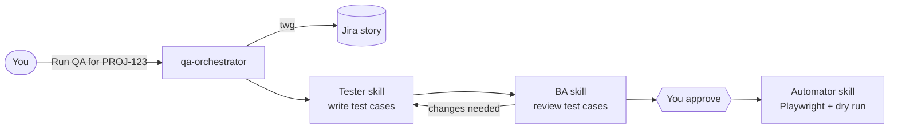

# QA agent POC: 1 orchestrator, 3 skills

## Flow



1. **Orchestrator** fetches the story and its acceptance criteria from Jira with `twg`.
2. **Tester skill** writes the test cases to `.qa/<KEY>/test-cases.md`.
3. **BA skill** reviews them against the story and writes `.qa/<KEY>/review.md`: approved, or a list of changes. If it asks for changes, the Tester revises once.
4. **You approve** in chat. You stand in for the real BA during the POC.
5. **Automator skill** writes `tests/e2e/<KEY>.spec.js` and dry-runs it.

## Files

```text
.agents/
├── agents/qa-orchestrator.md
└── skills/
    ├── tester/SKILL.md
    ├── ba/SKILL.md
    └── automator/SKILL.md
tests/e2e/            Playwright specs
.qa/<KEY>/            test cases + review per story
playwright.config.js
```

`twg` and `twg-workflows` are installed by the TWG CLI setup. You don't write them.

## What each piece does

**qa-orchestrator**
- Runs the steps in order and passes each skill's output to the next.
- Stops for your approval before the Automator starts.

**tester**
- Input: story and acceptance criteria.
- Output: test cases. Each one has an ID, steps, expected result, and the acceptance criterion it covers.

**ba**
- Input: story and test cases.
- Checks:
  - every acceptance criterion is covered
  - expected results are specific
  - nothing is invented beyond the story
- Output: approved, or a list of changes.

**automator**
- Input: the approved test cases.
- Output: one Playwright `test()` per case, with the case ID in the title.
- Runs the spec once and reports pass or fail.

## Setup

1. Install the Teamwork Graph CLI, run `twg login`, then run `twg doctor` to check it.
2. In this folder, run `npm install` and then `npx playwright install chromium`.
3. Set `APP_URL`, then save a login once with `npm run login -- <APP_URL>`.
4. Start the agent with `agy --agent qa-orchestrator` (or pick it in the Antigravity agent dropdown) and say `Run QA for PROJ-123`.

## Not in the POC

Zephyr, the CI/nightly batch, and SSO automation. Add them once the POC works on one real story.
